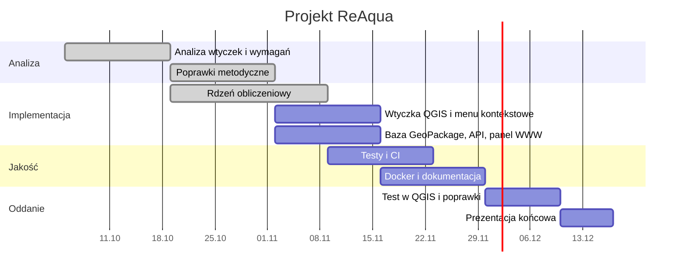

# Harmonogram i lista zadań

Daty są propozycją i wymagają dostosowania do terminów przedmiotu. Wersja do bieżącego uzupełniania z wykresami: `ReAqua_monitoring_postepu.xlsx`.

## 1. Wykres Gantta



## 2. Zadania do tablicy Kanban (GitHub Projects)

Kolumny: Todo, In Progress, Done. Wykonawcy są propozycją, do potwierdzenia przez zespół.

| Zadanie | Wykonawca | Kolumna |
|---------|-----------|---------|
| Analiza merytoryczna trzech wtyczek | Maciej Andrzejewski | Done |
| Rdzeń: klasyfikacja suszy i wybór lokalizacji | Maciej Andrzejewski | Done |
| Rdzeń: kriging i zasięg oddziaływania | Kacper Mikołajczyk | Done |
| Rdzeń: hydrologia, koszty, raport | Weronika Zator | Done |
| Baza GeoPackage | Tomasz Szulski | Done |
| API i panel WWW | Tomasz Szulski | Done |
| Wtyczka QGIS i menu kontekstowe | Maciej Andrzejewski | In Progress |
| Test wtyczki w QGIS 3.22 i najnowszym LTR | Weronika Zator | Todo |
| Weryfikacja źródeł literaturowych i współczynników | Kacper Mikołajczyk | Todo |
| Testy jednostkowe i integracyjne | Tomasz Szulski | Done |
| GitHub Actions | Tomasz Szulski | In Progress |
| Dockerfile i docker-compose | Kacper Mikołajczyk | In Progress |
| README i dokumentacja | Weronika Zator | In Progress |
| Test `docker compose up` | Tomasz Szulski | Todo |
| Prezentacja końcowa | Cały zespół | Todo |

## 3. Propozycje komunikatów commitów

```
Add NDVI/NDMI drought classification with reflectance scaling
Fix reservoir area taken from drought window area
Add anisotropic simple and ordinary kriging variants
Add GeoPackage writer for runs, reservoirs and metrics
Add Flask API with GeoJSON and CSV export
Add layer context menu entries to QGIS plugin
Add pytest suite for spectral, scout and kriging modules
Add scene upload queue and worker service to docker-compose
Add GitHub Actions workflow running flake8 and pytest
Document methodology and checklist mapping
```
